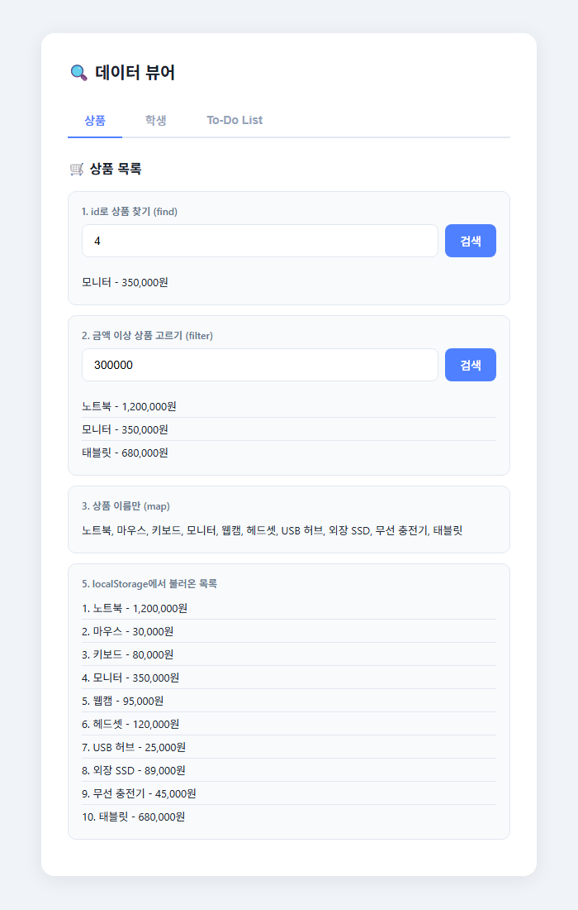
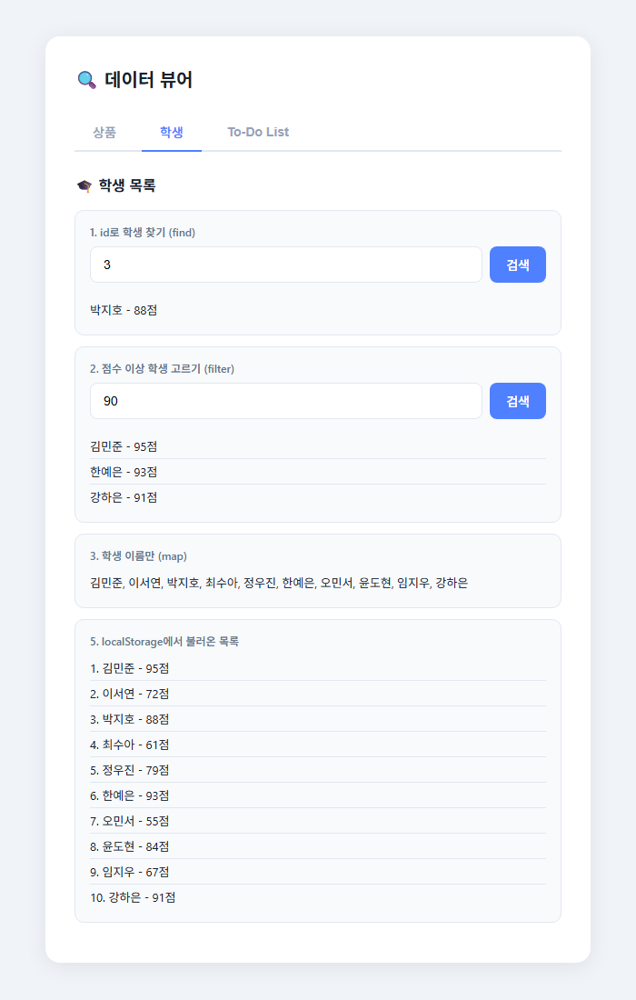
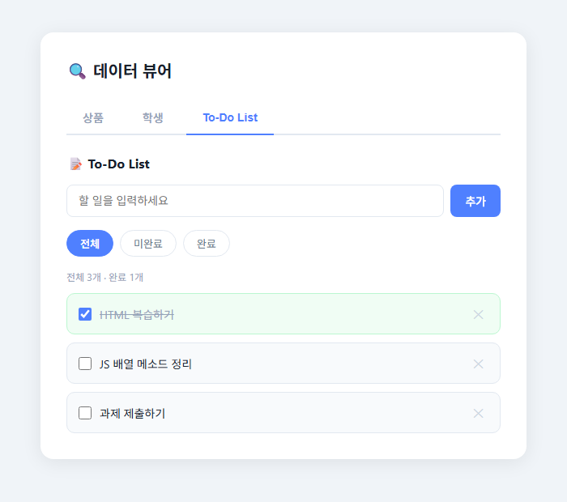

# JavaScript 배열 메소드 실습 — 데이터 뷰어

> **질문** 배열 메소드 `find`, `filter`, `map` 과 `localStorage` 를 화면에 직접 연결할 수 있을까?

> **답** 콘솔 실습(no1, no3)으로 메소드를 먼저 익히고, 입력값에 따라 결과를 보여 주는 탭형 데이터 뷰어와 To-Do List 로 확장했다.

📅 2026-06-08

---

## 기술 스택


---

## 학습 흐름

```
콘솔 실습 (no1, no3) ──▶ 입력값으로 검색 (find / filter) ──▶ 화면 렌더링 (map) ──▶ localStorage 저장 ──▶ To-Do List
```

---

## 파일 구성

| 파일 | 내용 |
|------|------|
| [no1.html](./no1.html) | 상품 배열로 `find` / `filter` / `map` / `localStorage` 연습 (콘솔 출력) |
| [no3.html](./no3.html) | 학생 배열로 같은 연습 (콘솔 출력) |
| [index.html](./index.html) | 상품 · 학생 · To-Do List 탭으로 구성한 데이터 뷰어 |
| [script.js](./script.js) | 데이터, 탭 전환, 검색, To-Do 기능 |
| [style.css](./style.css) | 카드형 레이아웃, 탭, 버튼 스타일 |

---

## 1. 콘솔 실습 — no1.html / no3.html

화면 없이 `console.log` 로 결과를 확인했다.

```js
const products = [
  { id: 1, name: "노트북", price: 1200000 },
  { id: 2, name: "마우스", price: 30000 },
  { id: 3, name: "키보드", price: 80000 }
];

products.find(p => p.id === 2);           // 조건에 맞는 첫 번째 요소 1개
products.filter(p => p.price >= 50000);   // 조건에 맞는 요소 전부 (새 배열)
products.map(p => p.name);                // 각 요소를 바꾼 새 배열

localStorage.setItem("products", JSON.stringify(products));   // 배열 → 문자열로 저장
const saved = JSON.parse(localStorage.getItem("products"));   // 문자열 → 배열로 복원
```

**콘솔 출력 (no1.html)**

```
1. {id: 2, name: '마우스', price: 30000}
2. [{id: 1, name: '노트북', price: 1200000}, {id: 3, name: '키보드', price: 80000}]
3. ['노트북', '마우스', '키보드']
5. [{…}, {…}, {…}]
```

**콘솔 출력 (no3.html)** — 학생 10명

```
1. {id: 3, name: '박지호', score: 88}
2. 70점 이상 7명 (김민준, 이서연, 박지호, 정우진, 한예은, 윤도현, 강하은)
3. ['김민준', '이서연', '박지호', '최수아', '정우진', '한예은', '오민서', '윤도현', '임지우', '강하은']
5. (10) [{…}, {…}, …]
```

| 메소드 | 돌려주는 것 | 못 찾으면 |
|--------|-------------|-----------|
| `find` | 요소 1개 | `undefined` |
| `filter` | 새 배열 (여러 개) | 빈 배열 `[]` |
| `map` | 같은 길이의 새 배열 | — |

---

## 2. 데이터 뷰어 — index.html

콘솔 실습을 화면으로 옮겼다. 입력창에 값을 넣고 **검색** 을 누르면 결과가 바로 아래에 나온다.

### 상품 탭

id `4` 로 찾기, `300000` 원 이상 고르기



### 학생 탭

id `3` 으로 찾기, `90` 점 이상 고르기



### 핵심 코드

```js
// 입력값 → filter → map 으로 HTML 만들기
function searchByPrice() {
  const price = parseInt(document.getElementById('productPriceInput').value);
  const filtered = products.filter(p => p.price >= price);
  document.getElementById('product-filter').innerHTML = filtered.length > 0
    ? filtered.map(p => `<div class="item">${p.name} - ${p.price.toLocaleString()}원</div>`).join('')
    : `<div class="item">해당 금액 이상의 상품이 없습니다.</div>`;
}
```

```js
// 탭 전환 : 전부 숨기고 누른 탭만 보이기
function showTab(tabName, btn) {
  document.querySelectorAll('.tab-content').forEach(t => t.classList.remove('active'));
  document.querySelectorAll('.tab-btn').forEach(b => b.classList.remove('active'));
  document.getElementById('tab-' + tabName).classList.add('active');
  btn.classList.add('active');
}
```

---

## 3. To-Do List

할 일 추가 · 완료 체크 · 삭제 · 전체/미완료/완료 필터. 새로고침해도 `localStorage` 에 남아 있다.



| 기능 | 사용한 메소드 |
|------|---------------|
| 완료 체크 토글 | `find` 로 해당 할 일 찾아 `status` 변경 |
| 삭제 | `filter` 로 해당 id 만 빼고 새 배열 |
| 미완료 / 완료 보기 | `filter` 로 `status` 별 목록 |
| 화면 그리기 | `map` 으로 HTML 문자열 만들기 |
| 저장 / 불러오기 | `JSON.stringify` / `JSON.parse` + `localStorage` |

```js
// filter 사용 - 삭제
function deleteTodo(id) {
  todos = todos.filter(t => t.id !== id);
  saveToLocalStorage();
  render();
}
```
