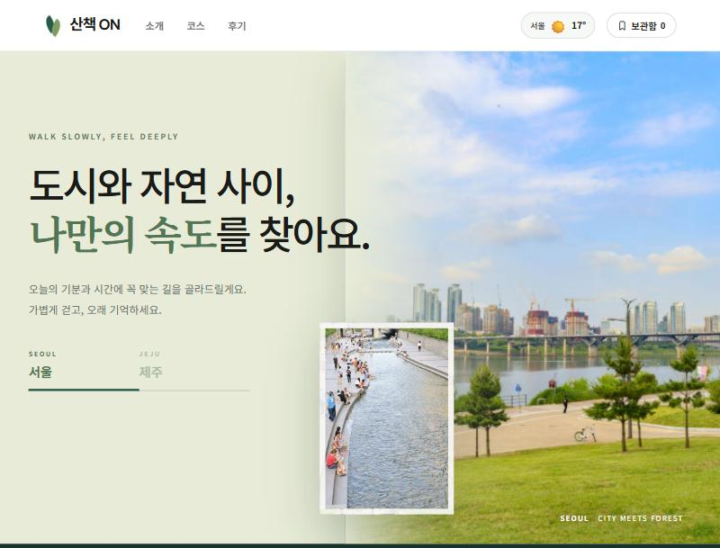

# Web — HTML·CSS 이론 학습 및 팀 프로젝트

W3Schools 예제와 Do it! 교재로 HTML·CSS 기초를 익히고, 카카오맵·기상청 API를 연동한 산책 코스 가이드 웹 서비스를 팀 프로젝트로 완성했다.

---

## 기술 스택

---

## 학습 흐름

- HTML 기초 태그 및 문서 구조
- CSS 선택자·박스 모델
- float·position 레이아웃
- HTML·CSS 심화 실습 (게시판, 도형, 2단 레이아웃)
- 팀 프로젝트 — 카카오맵·기상청 API 연동 웹 서비스

---

## 폴더 구성

| 폴더 | 주제 |
|------|------|
| [w3school](./w3school/) | HTML 기초 — 요소·속성·제목·단락 |
| [260309](./260309/) | HTML + CSS 첫 실습 — 프로필 페이지 |
| [260316](./260316/) | HTML 미디어·링크 실습 |
| [260323](./260323/) | HTML 실습 과제 |
| [260330](./260330/) | HTML Chapter07 퀴즈 |
| [260406](./260406/) | CSS float·position 레이아웃 실습 |
| [260511](./260511/) | HTML·CSS 심화 — 게시판·도형·2단 레이아웃 |
| [korea_travel](./korea_travel/) | **팀 프로젝트** — 서울·제주 산책 코스 가이드 |

---

## 팀 프로젝트 — [산책 ON](./korea_travel/)

카카오맵 API와 기상청 단기·중기예보 API를 연동해 서울·제주 산책 코스 검색·지도·날씨를 한 화면에서 제공하는 웹 서비스.

| 역량 | 내용 |
|------|------|
| 컴포넌트 분리 구조 | `index.html` 쉘 + `loader.js` fetch 조립 방식 |
| 카카오맵 API 연동 | 코스별 마커·오버레이·경로 표시 |
| 기상청 API 파싱 | 단기예보(0일부터 3일) + 중기예보(4일부터 7일) 병합으로 7일 예보 구성 |
| Python 백엔드 | 표준 라이브러리만으로 정적 파일 서빙 + API 프록시 |
| 조건 검색 필터 | 지역·테마·시간·난이도 조합 동적 렌더링 |

---

## 참고 교재

> *Do it! HTML+CSS+자바스크립트 웹 표준의 정석*
