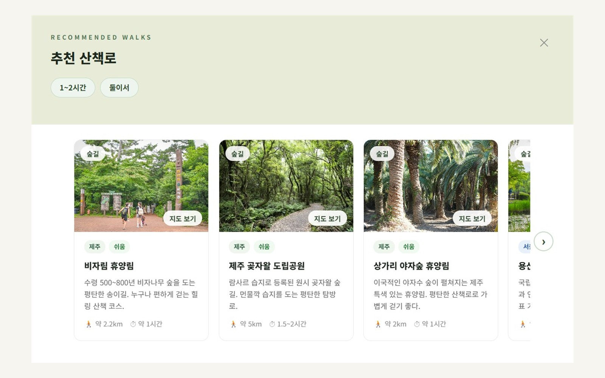
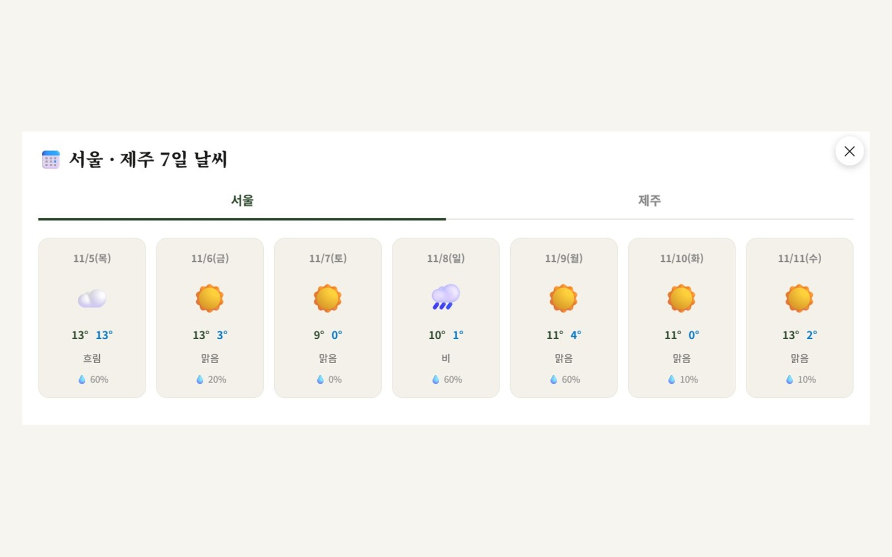
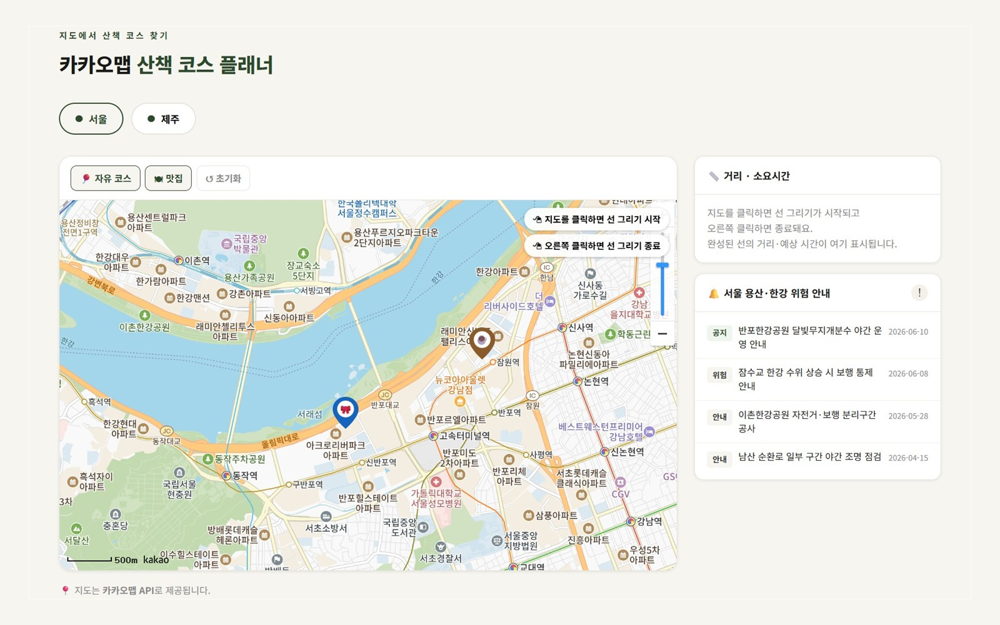

# 산책 ON — 서울·제주 산책 코스 가이드

카카오맵과 기상청 API로 서울·제주의 새로운 산책 코스, 맛집, 7일 날씨, 후기를 한 화면에서 보여 주는 3인 팀 프로젝트입니다.

---

## 기획 배경

여행을 가든, 일상에서 걷든 많은 사람들이 **늘 같은 산책 코스**로 갑니다.

그래서 우선 **서울 용산 일대와 제주**로 지역을 좁혀,
**새로운 산책 코스 · 맛집 · 7일 날씨**를 함께 보여 주는 서비스를 기획했습니다.

또한 **다른 사람들의 후기**를 보고 코스를 고를 수 있도록 리뷰 기능도 기획했습니다.

---

## 기술 스택


---

## 주요 기능

| 기능 | 구현 방법 |
|------|-----------|
| 조건별 코스 추천 | 장소·시간·함께 걷는 사람 조건을 조합해 코스 목록을 화면에 그림 |
| 7일 날씨 | 기상청 단기예보(0일부터 3일)와 중기예보(4일부터 7일)를 합쳐 7일 예보 구성, 기상특보 조회 |
| 카카오맵 코스 플래너 | 코스·맛집 마커 표시, 지도에 선을 그려 거리·예상 시간 계산 |
| 후기 | 코스 후기와 맛집 후기를 탭으로 나눠 표시 |

---

## 서비스 흐름


---

## 화면

<table>
  <tr>
    <td width="50%"></td>
    <td width="50%"></td>
  </tr>
  <tr>
    <td align="center"><b>메인</b> — 서울·제주를 골라 시작</td>
    <td align="center"><b>추천 산책로</b> — 조건에 맞는 코스와 거리·시간</td>
  </tr>
  <tr>
    <td width="50%"></td>
    <td width="50%"></td>
  </tr>
  <tr>
    <td align="center"><b>7일 날씨</b> — 기상청 단기 + 중기예보</td>
    <td align="center"><b>카카오맵 플래너</b> — 마커·거리 계산·위험 안내</td>
  </tr>
</table>

---

## 폴더 구조

```
korea_travel/
├── index.html          # 진입점 (화면 조각을 담는 빈 틀)
├── server.py           # 정적 파일 제공 + 기상청 API 중계
├── 날씨서버_실행.bat     # 더블클릭으로 서버 실행
├── html/               # 화면 조각 (loader.js가 조립)
├── js/                 # 코스 데이터 · 지도 · 날씨 로직
├── css/
└── images/
```

---

## 실행 방법

**사전 준비**
- Python 3.7 이상 (3.13에서 실행 확인), 별도 패키지 설치 없음
- 인터넷 연결 (카카오맵 · 기상청 API 호출)
- 기상청 API 인증키 (`server.py`의 `SERVICE_KEY`)

**1. 서버 실행**

`날씨서버_실행.bat`을 더블클릭하면 서버가 켜지고 브라우저가 자동으로 열립니다.

또는 이 폴더에서 직접 실행합니다.

```bash
python server.py
```

**2. 브라우저 접속**

```
http://localhost:8000
```

※ `index.html`을 바로 열지 말고, 서버를 켠 뒤 위 주소로 접속해야 합니다.
