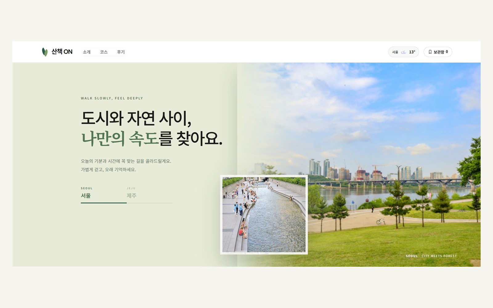
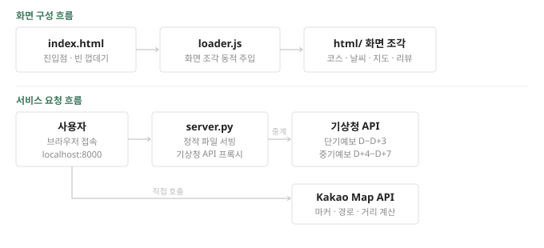
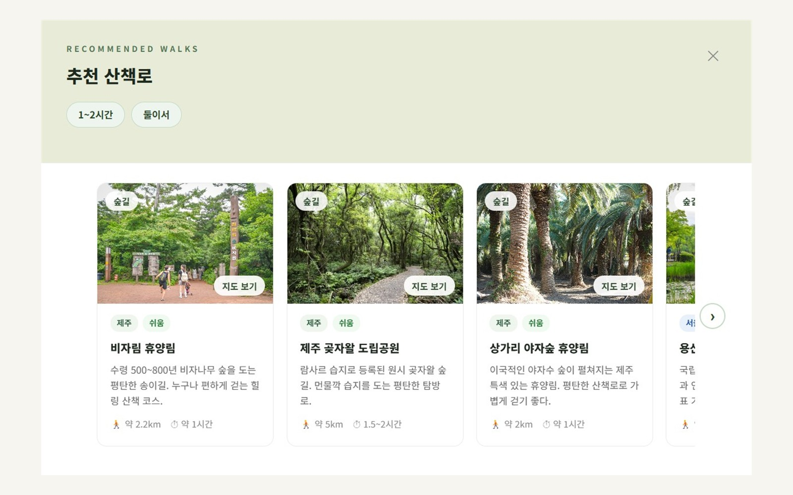
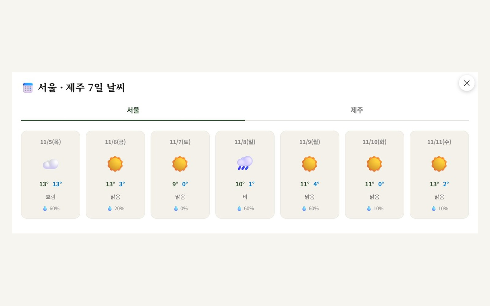
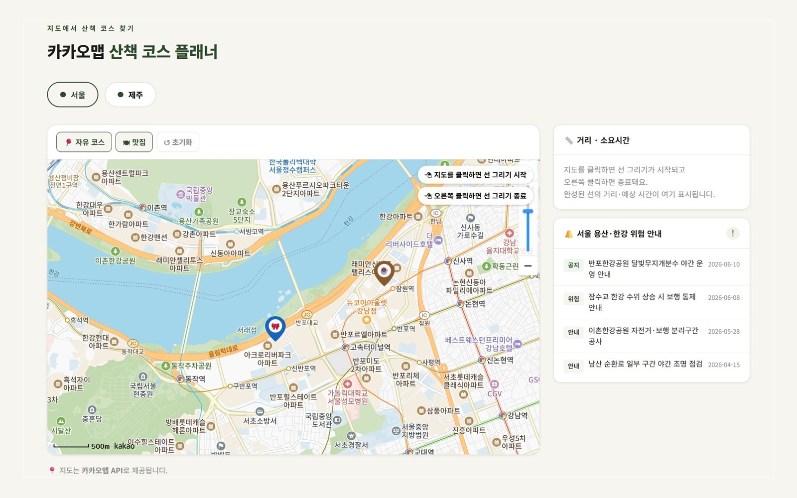

<div align="center">

# 산책 ON

서울과 제주의 산책 코스, 맛집, 날씨 정보를 한 화면에서 — **Kakao Map · 기상청 API**



</div>

## 1. 프로젝트 개요

늘 같은 코스만 걷는 사람들을 위해, 서울 용산과 제주의 새로운 산책 코스 · 맛집 · 7일 날씨를 한 화면에서 보여주는 서비스입니다. 다른 사람들의 후기를 보고 코스를 고를 수 있는 리뷰 기능도 함께 제공합니다.

- 목표: 코스 추천, 7일 날씨, 지도 플래너, 리뷰를 하나의 화면에서 제공
- 기간: 2026.06
- 규모: 서울(용산구), 제주도 코스 제공 / API 2종 연동

| 영역 | 기술 | 사용 이유 |
|------|------|----------|
| 프론트엔드 | HTML5, CSS3, JavaScript (Vanilla) | 별도 프레임워크 없이 경량 구현 |
| 백엔드 | Python 3.7+ (표준 라이브러리) | 추가 패키지 없이 프록시 서버 구현 |
| 지도 | Kakao Map JavaScript API | 국내 주소·경로 데이터 정확도 |
| 날씨 | 기상청 단기·중기예보 API | 공공데이터포털 무료 제공 |

## 2. 서비스 구조

<p align="center">
  
</p>

## 3. 실제 구현 화면

### 산책 ON 주요 화면

| 메인 화면 | 코스 추천 결과 |
| --- | --- |
|  |  |
| ① 메인 화면 · 코스 탐색 · 서비스 소개 | ② 코스 추천 결과 · 필터 적용 후 목록 표시 |

| 7일 날씨 | 카카오맵 플래너 |
| --- | --- |
|  |  |
| ③ 7일 날씨 예보 · 단기 + 중기 합산 표시 | ④ 카카오맵 코스 플래너 · 경로 및 거리 계산 |

## 4. 주요 기능

### 4-1. 코스 추천
장소, 소요 시간, 동행 유형(혼자 / 연인 / 가족 등)으로 필터링해 코스를 추천한다. 코스별 거리와 예상 소요 시간을 함께 표시하며, 서울 용산구와 제주도 코스를 제공한다.

### 4-2. 7일 날씨 예보
기상청 단기예보(D ~ D+3)와 중기예보(D+4 ~ D+7)를 날짜 기준으로 병합해 7일 연속 예보를 제공한다. 기상 특보 발효 시 경고를 함께 표시한다.

### 4-3. 카카오맵 코스 플래너
코스 경유지와 주변 맛집을 지도 마커로 표시한다. 경유지 간 경로를 선으로 연결해 거리와 예상 소요 시간을 계산하고, 위험 구간 안내도 제공한다.

### 4-4. 리뷰
코스 리뷰와 맛집 리뷰를 탭으로 분리해 제공한다.

## 5. 문제 해결 경험

### 1) 기상청 API CORS 오류

- 문제: 브라우저에서 기상청 API를 직접 호출하면 CORS 정책으로 응답 차단
- 원인 분석: 기상청 API 서버가 브라우저 직접 요청에 대해 CORS 헤더를 반환하지 않음
- 해결: `server.py`에 프록시 엔드포인트를 추가해 서버가 대신 호출 후 결과를 전달
- 결과: 기상청 API 정상 연동

### 2) 7일 날씨 예보 단절

- 문제: 단기예보와 중기예보를 각각 받으면 D+3과 D+4 사이가 끊어짐
- 원인 분석: 두 API의 응답 필드명과 형식이 달라 단순 합산 불가
- 해결: 날짜 기준으로 두 응답을 파싱해 하나의 배열로 병합
- 결과: 7일 연속 날씨 예보 표시

### 3) 화면 단편화 관리

- 문제: 기능별 HTML 파일이 나뉘어 있어 `index.html`에서 모두 불러오면 코드가 복잡해짐
- 원인 분석: 하나의 파일에 모든 기능을 넣으면 유지보수가 어려워 화면을 조각으로 분리했으나 조립 방식이 없었음
- 해결: `loader.js`를 작성해 필요한 화면 조각을 동적으로 주입, `index.html`은 진입점만 담당
- 결과: 화면 조각 단위 수정 가능, `index.html` 단순 유지

## 6. 한계와 개선 방향

- 하드코딩 데이터: 코스·맛집 정보가 `course_data.js`에 고정되어 있어 추가·수정 시 코드 직접 편집 필요, DB 연동으로 개선 가능
- 리뷰 기능 미완성: 조회만 가능하며 작성·저장 기능 없음
- API 키 노출: 기상청 API 키가 `server.py`에 평문 저장, 공개 배포 시 환경 변수로 분리 필요
- 로컬 실행 전용: 배포 환경 미구성, Vercel 등 클라우드 배포로 확장 가능

## 실행 방법과 폴더 구조

### 사전 준비

1. Python 3.7 이상 설치 (추가 패키지 불필요)
2. 기상청 API 키 발급 → [공공데이터포털](https://www.data.go.kr)
3. `server.py` 상단의 `SERVICE_KEY` 값을 발급받은 키로 교체

```python
# server.py
SERVICE_KEY = "여기에_기상청_API_키_입력"
```

### 서버 실행

```bash
python server.py
```

브라우저에서 http://localhost:8000 접속
(`index.html` 직접 실행 시 기상청 API 동작 안 함)

### 폴더 구조

```
korea_travel/
├── index.html              # 진입점
├── server.py               # 정적 파일 서빙 + 기상청 API 프록시
├── 날씨서버_실행.bat        # Windows 더블클릭 실행
├── html/                   # 화면 조각
├── js/
│   ├── loader.js           # 화면 조각 동적 로드
│   ├── course_data.js      # 코스·맛집 데이터
│   ├── map.js              # 카카오맵 연동
│   └── weather.js          # 기상청 API 호출·파싱
├── css/
└── images/
```

## 7. 프로젝트를 통해 얻은 경험

- 화면 구조 설계: HTML을 기능 단위로 분리하고 `loader.js`로 동적 조립하는 SPA 유사 구조 구현
- 팀 협업: 화면별 역할 분담 후 `index.html` 단일 진입점으로 통합하는 방식으로 충돌 최소화
